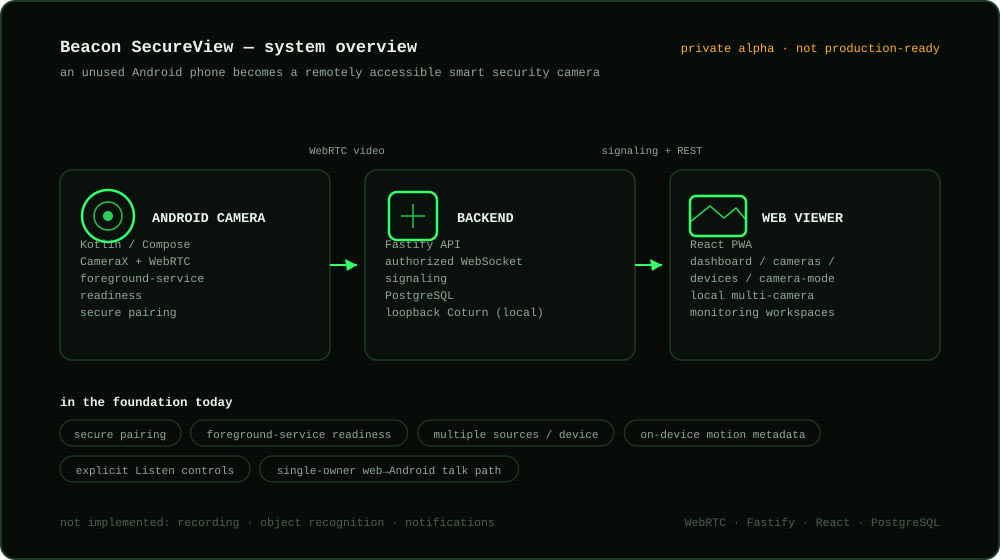

# Beacon View

Beacon View is a device-agnostic camera platform. Android devices and
attended HTTPS browsers can produce video; responsive browsers can view it; and
one device may expose several independently named camera sources.

Beacon View is an Android-first system intended to turn an unused Android
phone into a remotely accessible smart security camera. The current foundation
includes secure pairing, foreground-service camera readiness, authorized
multi-viewer WebRTC, multiple sources per device, responsive device management,
local multi-camera monitoring workspaces, explicit Listen controls, a single-owner
web-to-Android talk path, Android privacy mode, and on-device motion metadata.
Later approved milestones add opt-in encrypted short clips exported to user-owned
Google Drive, notification transport, household sharing, and an Electron desktop
client. Trained object detection remains experimental foundation work.
The [roadmap](docs/roadmap.md) records the remaining release acceptance gates.

<p align="center">
  
</p>

Development follows the [testing policy](docs/testing-policy.md): protect realistic
regressions with the smallest useful suite. Per-feature behaviour notes live in
[docs/feature-notes.md](docs/feature-notes.md).

## Repository layout

- `apps/android-camera` — Kotlin/Compose CameraX and WebRTC camera client
- `apps/backend` — Fastify API, authorized WebSocket signaling, and PostgreSQL
- `apps/web-viewer` — React account, camera, and browser WebRTC interface
- `packages/shared-types` — platform-neutral TypeScript contracts
- `packages/config` — shared TypeScript configuration
- `infrastructure` — loopback-only local PostgreSQL and Coturn
- `docs` — architecture, security, testing, and development guidance

## Quick start on Windows

Prerequisites are Node.js 22.13+ within Node 22, pnpm 11.9.0, and Docker
Compose. JDK 17 and Android SDK 35 are needed for Android.

```powershell
.\Start-Beacon.ps1
```

Stop and validate with:

```powershell
.\Stop-Beacon.ps1
.\Test-Beacon.ps1
```

The launcher installs pinned dependencies, creates missing local configuration,
starts Docker services, applies migrations, starts HTTPS/WSS LAN development,
and opens Beacon. See the [Windows quick start](docs/quick-start.md) for Android
installation and useful options, or
[local development](docs/local-development.md) for lower-level commands. This
project is not production-ready.

For the recommended local/GitHub workflow, see the
[development handoff](docs/development-handoff.md). GitHub is the source of
truth; work on a `codex/*` feature branch, open a pull request, and merge to
`main` only after CI passes. Automatic Oracle deployment is currently disabled;
an owner-authorized release deploys the exact validated merged commit using the
[release-directory procedure](docs/github-web-deployment.md).

## Product surfaces

- Dashboard: `/`
- Cameras (list view, or a grid view for watching several at once): `/cameras`
- Devices: `/devices`
- Browser Camera Mode: `/camera-mode`
- Development diagnostics: `/diagnostics`

The web viewer is also an installable PWA (manifest, generated icons, and an
app-shell-only service worker at `apps/web-viewer/public/sw.js`); it never
caches `/api/*` or the events WebSocket.

Browser Camera Mode requires explicit permission and trusted HTTPS. It is for
attended use because browsers may throttle background tabs. See
[Browser Camera Mode](docs/browser-camera-mode.md),
[multi-camera architecture](docs/multi-camera-architecture.md), and
[multi-viewer testing](docs/multi-viewer-testing.md).

The current foundation establishes independent multi-camera tiles and local
workspace layouts in addition to resilient producer reconnect, device/camera
separation, browser producers, independent multi-viewer sessions, privacy mode,
and one-way camera audio. Recording, motion/events, notifications, distributed
presence/signaling, production deployment, SFU fan-out, iOS/desktop agents, and
IP-camera adapters remain future roadmap work.

---

_Built by [Hans Sai](https://builtbysai.com)._

## License

Beacon View is licensed under the [GNU Affero General Public License v3.0](LICENSE). If you run a modified version
as a network service, the AGPL requires you to offer your users the source of your changes. To report a security
problem, see [SECURITY.md](SECURITY.md).
