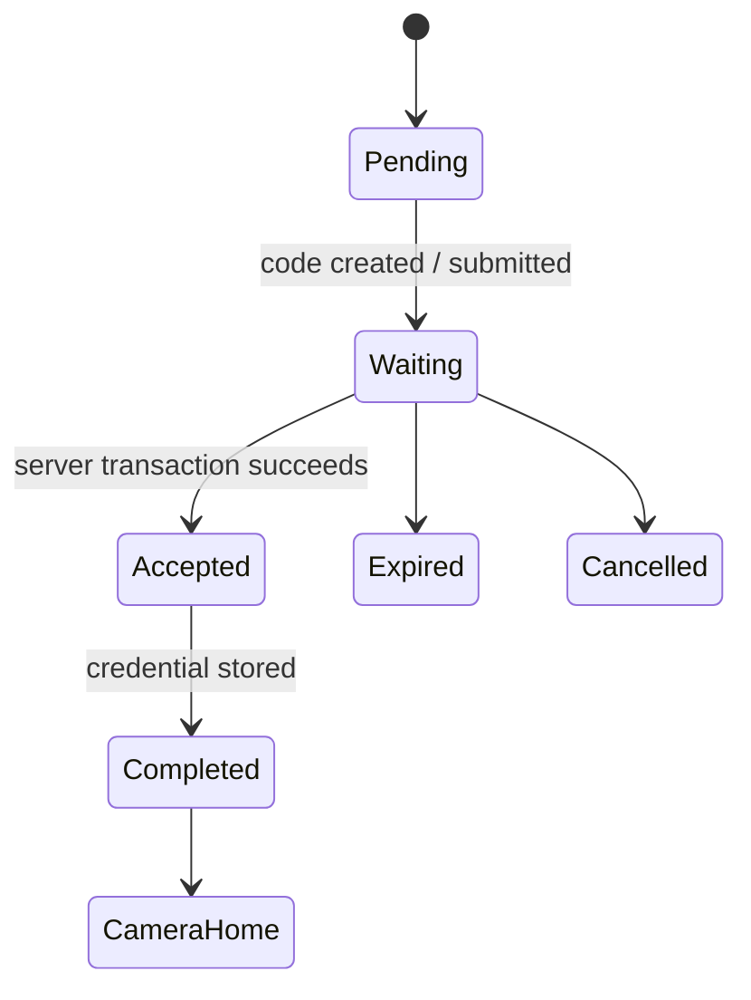
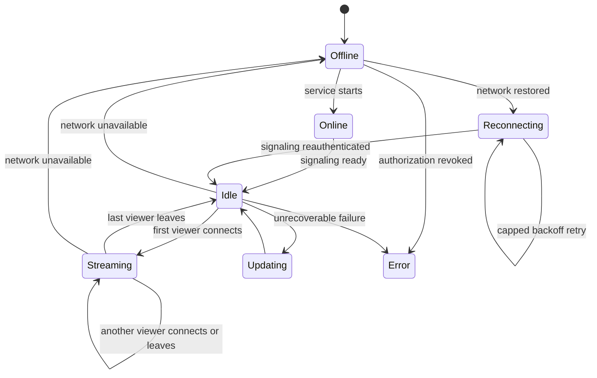
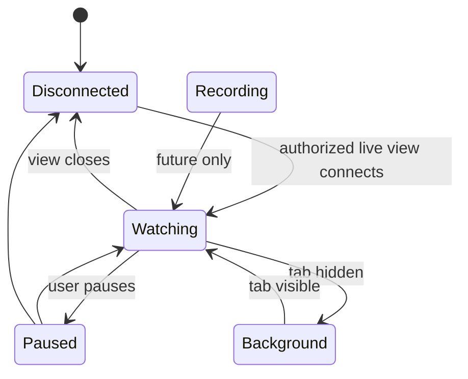
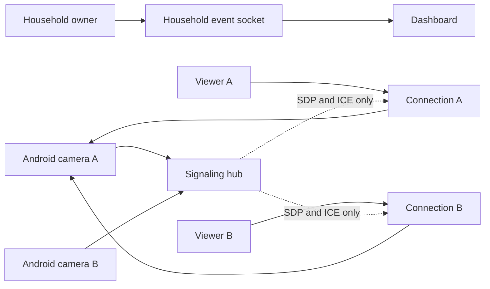

# Device, pairing, and viewer lifecycle

Beacon treats the Android camera as an independent appliance. The foreground
camera service owns heartbeat, network observation, signaling, and active
WebRTC sessions. The activity renders service state; closing or recreating the
activity does not own or stop the camera.

## Pairing

The server consumes the code and creates the camera credential in one database
transaction. It then emits a household-scoped `camera-paired` event. The
browser shows a success state, closes the pairing wizard, navigates to Cameras,
and highlights the new camera. Android stores the credential, shows success,
and enters Camera Home.

## Camera device

`Online` is the service startup state; `Idle` means signaling is connected and
the camera is ready. A viewer disconnect closes only that connection ID. The
foreground service and device socket remain active. Capture is visibly
indicated by the app and persistent notification.

Privacy mode is stored on the Android device record. Enabling it makes viewer
authorization fail immediately, closes every active viewer, and sends a command
over the still-authenticated device control socket. Android then closes its peer
sessions and releases CameraX/WebRTC media while retaining its credential so
privacy can be disabled without pairing the device again.

## Viewer

Recording is reserved as an explicit future state and is not implemented.
Browser cleanup sends a disconnect for its connection only. Network failures
use bounded exponential reconnect without changing pairing state.

## Realtime application updates

Authenticated browsers keep `/api/events` open as a WebSocket. Events contain
only public camera identifiers and generic lifecycle changes. Pairing,
heartbeat presence, and revocation trigger a camera-store refresh. The socket
is origin-checked, session-authenticated, and household-isolated.

## Multi-camera and multi-viewer direction

Signaling sessions are keyed by random connection ID rather than camera ID.
Each viewer has independent authorization, negotiation, cleanup, and
diagnostics. Media remains peer-to-peer; the backend never becomes a media
relay.

## Android lifecycle expectations

- The service is started only after pairing and visible camera permission.
- A persistent notification identifies Camera Mode.
- Camera Mode opens the selected source immediately and maintains a visible local
  preview even when no remote viewer is connected. Authorized viewers attach to
  that ready capture pipeline instead of cold-starting CameraX.
- Rotation and activity recreation observe the same service state.
- Leaving the activity, turning off the screen, or removing the activity from
  recents does not stop signaling or heartbeat.
- `Stop camera`, credential revocation, or moving to a new account closes every
  peer connection and releases CameraX resources.
- Source switching completes the CameraX stop callback before disposing the old
  WebRTC source, preventing callbacks into released native memory.
- Android default-network callbacks and capped exponential backoff reconnect the
  existing credential; network loss never causes re-pairing.

## Current limits

Video is one selected source at 640×480 and up to 24 fps. One-way microphone audio is
sent with the live session but viewer playback is muted until Listen is explicitly
chosen. Recording remains disabled.
If microphone permission is denied, Camera Mode remains available as video-only and
the notification describes camera capture only. A later grant restarts the media
service so Android applies the microphone foreground-service type before audio capture.
When privacy mode is enabled, the persistent notification changes to **Beacon privacy
is on — Camera and microphone are off**. CameraX and microphone resources close
immediately. The service retains Android's camera foreground-service classification
because Android 14 and newer reject an already-running foreground service with type
`none`; actual camera and microphone operations and privacy indicators remain inactive
while the authenticated control connection stays available.
Front and rear sources are registered when available. Running
several independent peer encoders on an older phone can be resource-intensive;
production fan-out limits and thermal policy still need device profiling.

## Management states and actions

Device lifecycle is explicit:

`pairing -> registering -> online -> idle -> streaming`

Transient connectivity moves an enabled device through `offline` and
`reconnecting` without changing credentials. Management states are separate:

- **Disabled** preserves registration and credentials but refuses producer and
  viewer signaling.
- **Revoked** invalidates the device credential, terminates every child-source
  session, and requires pairing again.
- **Deleted** terminates sessions and removes the device, credential, and child
  records from the household.
- **Authentication required** is terminal until the user pairs again.

Restarting a device session closes its producer sockets and viewer negotiations;
the enabled, authorized producer reconnects with bounded backoff.

## Background operation

Android owns CameraX and WebRTC in a visible camera foreground service with
`stopWithTask=false`. Activity recreation, leaving the activity, and screen-off
do not intentionally stop the service. Android and device manufacturers may
still restrict camera access, networking, or process lifetime under battery
optimization, thermal pressure, permission changes, or vendor-specific power
management. The app reports when it is not exempt from battery optimization and
instructs the user to allow unrestricted battery use. It does not request a
silent exemption or claim that every manufacturer permits uninterrupted
screen-off capture.

Camera readiness is published only after CameraX confirms that capture bound
successfully. When Android rejects a background privacy resume under while-in-use
permission rules, signaling stays available, the UI asks the user to open Beacon,
and the foreground Activity start retries capture without re-pairing.

Browsers remain attended producers. Background tabs may be throttled or
suspended and are not presented as equivalent to Android foreground service.
