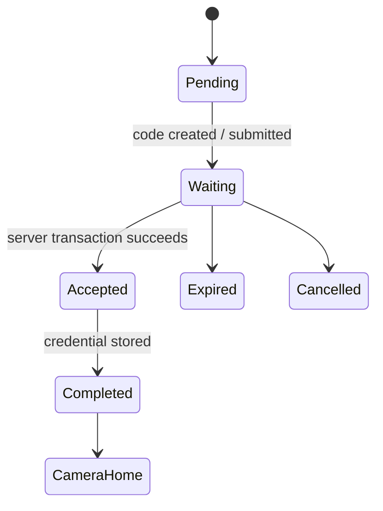
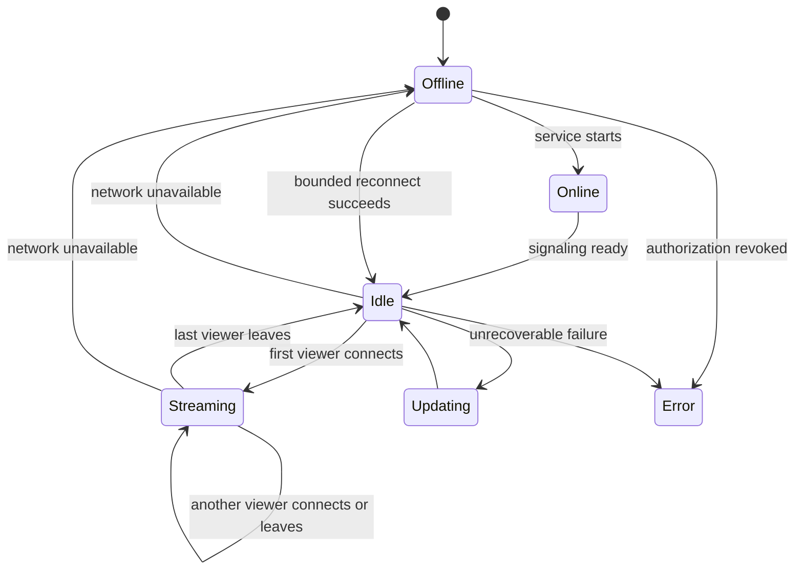
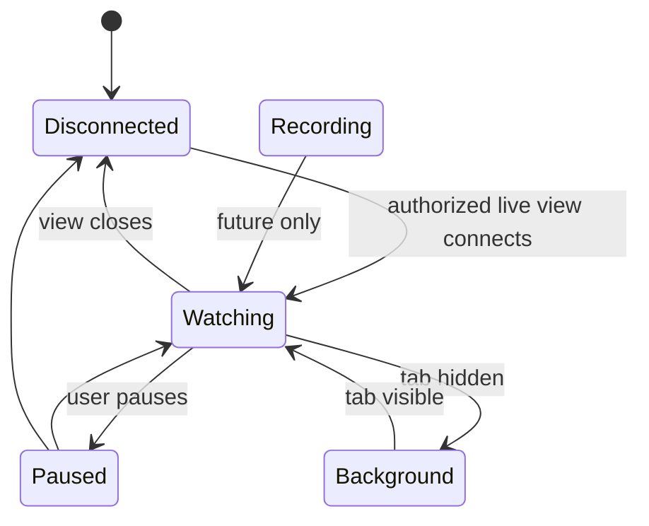
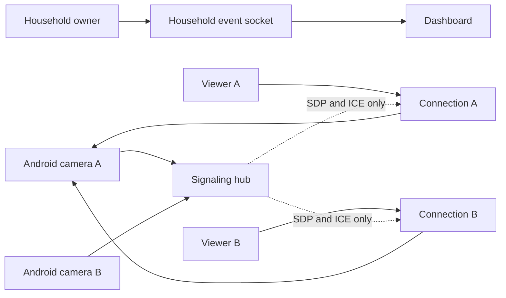

# Device, pairing, and viewer lifecycle

Beacon treats the Android camera as an independent appliance. The foreground
camera service owns heartbeat, network observation, signaling, and active
WebRTC sessions. The activity renders service state; closing or recreating the
activity does not own or stop the camera.

## Pairing

The server consumes the code and creates the camera credential in one database
transaction. It then emits a household-scoped `camera-paired` event. The
browser shows a success state, closes the pairing wizard, navigates to Cameras,
and highlights the new camera. Android stores the credential, shows success,
and enters Camera Home.

## Camera device

`Online` is the service startup state; `Idle` means signaling is connected and
the camera is ready. A viewer disconnect closes only that connection ID. The
foreground service and device socket remain active. Capture is visibly
indicated by the app and persistent notification.

## Viewer

Recording is reserved as an explicit future state and is not implemented.
Browser cleanup sends a disconnect for its connection only. Network failures
use bounded exponential reconnect without changing pairing state.

## Realtime application updates

Authenticated browsers keep `/api/events` open as a WebSocket. Events contain
only public camera identifiers and generic lifecycle changes. Pairing,
heartbeat presence, and revocation trigger a camera-store refresh. The socket
is origin-checked, session-authenticated, and household-isolated.

## Multi-camera and multi-viewer direction

Signaling sessions are keyed by random connection ID rather than camera ID.
Each viewer has independent authorization, negotiation, cleanup, and
diagnostics. Media remains peer-to-peer; the backend never becomes a media
relay.

## Android lifecycle expectations

- The service is started only after pairing and visible camera permission.
- A persistent notification identifies Camera Mode.
- Rotation and activity recreation observe the same service state.
- Leaving the activity, turning off the screen, or removing the activity from
  recents does not stop signaling or heartbeat.
- `Stop camera`, credential revocation, or pairing a new account closes every
  peer connection and releases CameraX resources.
- Android network callbacks and bounded exponential backoff reconnect the
  existing credential; network loss never causes re-pairing.

## Current limits

Video is rear-camera, 640×480 at 15 fps, with no audio or recording. Running
several independent peer encoders on an older phone can be resource-intensive;
production fan-out limits and thermal policy still need device profiling.
