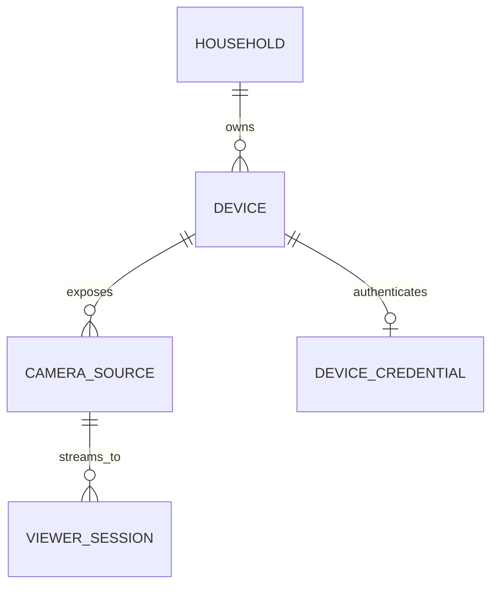

# Multi-camera architecture

Beacon separates a device identity from independently viewable camera sources.

The historical PostgreSQL `cameras` table is retained as the device table to
preserve existing IDs, credentials, pairing history, and audit references.
`camera_sources` supplies new public camera IDs and source metadata. A migration
creates a default source for every existing Android registration, so existing
phones do not pair again.

Android enumerates Camera2 sources and registers front and rear when present.
Current capture allows one selected source at a time and shares that capture
among viewer peer connections. Browser Camera Mode registers every
permission-visible input beneath one browser device and publishes the selected
source. Capability data leaves room for future concurrent capture without
pretending current hardware supports it.

The producer interface is per camera source and viewer connection ID. This is
compatible with a future SFU: media fan-out can change without changing
household, device, camera, or viewer identities.
