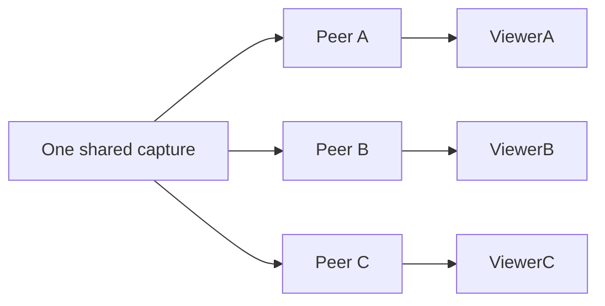

# Multi-viewer testing

One producer signaling socket may own many independent viewer sessions. Every
viewer has a random connection ID and its own `RTCPeerConnection`. Closing or
failing one removes only that connection. Shared capture stops after the final
viewer leaves.

1. Start one Android or browser camera.
2. Open its live view in two authenticated browser windows.
3. Confirm the viewer count reaches two and both videos advance.
4. Close Viewer A; Viewer B remains live and count becomes one.
5. Open Viewer C; the existing session must not restart.
6. Interrupt one viewer's network; the other remains live.
7. Close the final viewer; the producer becomes idle while signaling stays up.

The authenticated diagnostics endpoint exposes public camera IDs, connection
IDs, producer presence, and counts. It never exposes credentials, cookies, SDP,
raw ICE candidates, household IDs, or internal database IDs.
